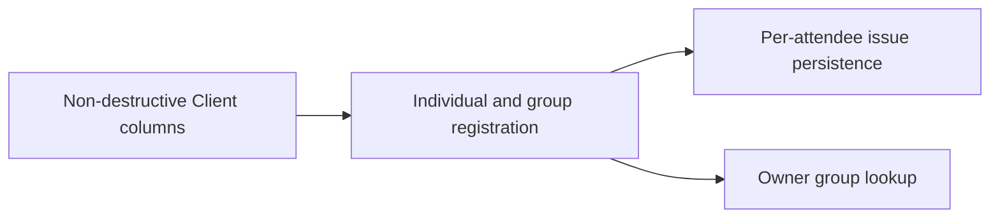

# Implementation Plan: Group Booking Domain

Source spec: `spec/SPEC-group-booking-domain.md`

## Overview

Extend the private Apps Script client model so a group submission creates or reuses individually coded clients, links them to a private booking contact, and lets the PIN-protected owner lookup retrieve the linked group. The public intake and owner presentation modules consume this API afterward.

## Dependency Graph

## Architecture Decisions

- Keep individual attendees as `Clients`; a private group ID links attendees rather than creating a group client that would merge clinical histories.
- Submit each group only after all attendee checklists are complete, so one locked request writes the complete group without returning prior codes.
- Make `setup` append missing `Clients` headings only; existing private data must remain intact.
- Retain one client code per appointment and all existing scheduling logic.

## Task List

### Phase 1: Registration foundation

- [x] Task 1: Extend the private client schema and public registration API.
  - Acceptance: `setup` preserves existing rows while adding Gender, group-link, and booking-contact headings; individual registration validates and persists Female/Male gender; group registration validates 1–10 complete attendees and creates or reuses each individual client under the existing lock.
  - Verify: `node --check clinic/Code.gs`; manually run `setup` on a test Sheet with existing rows and submit individual plus two-attendee group test payloads.
  - Files: `clinic/Code.gs`

### Phase 2: Private group retrieval

- [ ] Task 2: Persist group issue lists and extend PIN-protected owner lookup.
  - Acceptance: group registration persists every attendee’s own issues and returns only newly created codes; repeated matches keep their existing code private; an owner lookup returns the selected attendee’s gender, booking contact, and linked attendee summaries.
  - Verify: `node --check clinic/Code.gs`; manually inspect the private Sheet and call `lookup` with a test owner PIN for both a new and a reused attendee.
  - Dependencies: Task 1.
  - Files: `clinic/Code.gs`

### Checkpoint: Domain API

- [ ] Existing individual registration, status lookup, visits, and scheduling still parse and retain their prior request/response behavior.
- [ ] Group test data shows one private contact and separate attendee records/codes.
- [ ] No existing code appears in a public group-registration response.

## Risks and Mitigations

| Risk | Impact | Mitigation |
|---|---|---|
| Existing Sheet headings differ from the new schema | High | Append only missing headings by name; never reorder or recreate a populated sheet. |
| A shared booking-contact phone triggers accidental duplicate matches | High | Match all approved identity fields: normalized name, age, gender, and booking-contact phone. |
| A public response leaks a reused code | High | Build the response from newly created records only; verify with a repeat submission. |
| Apps Script is unavailable locally | Medium | Use syntax parsing locally and document the focused manual test against a private test Sheet. |

## Open Questions

None.
